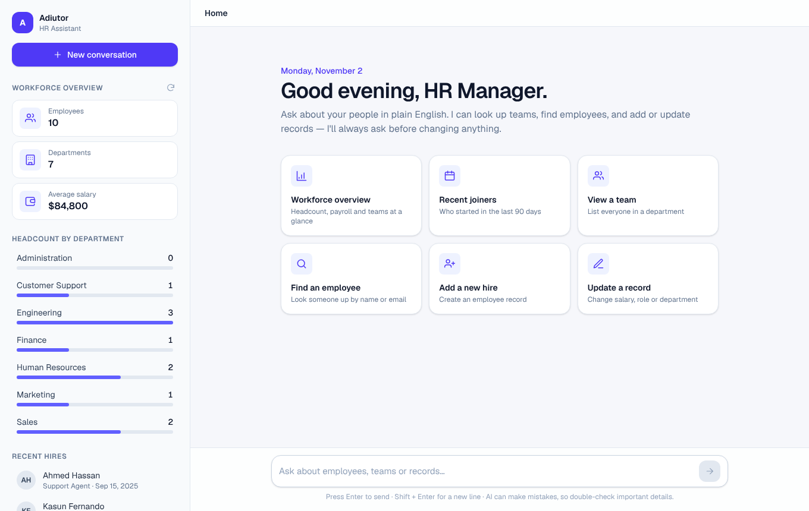
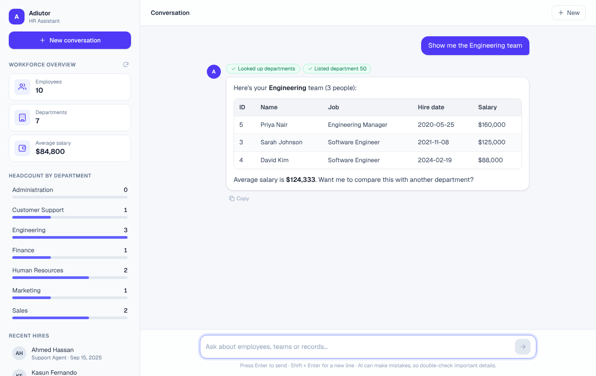
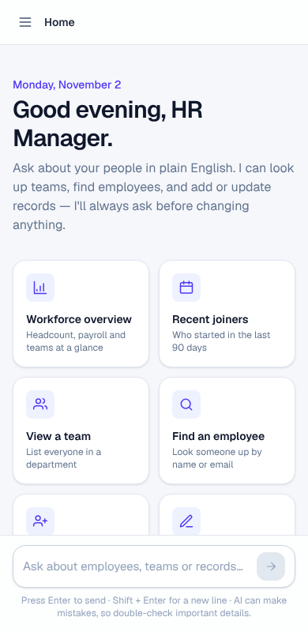

# What changed in Adiutor (and why)

This guide explains every improvement in plain English. Each section has
**Before**, **Now** and **Why it matters**, usually with a small example.

You don't need to be a programmer to follow the "Why it matters" parts.

---

## Quick summary

| # | Area | Before | Now |
|---|------|--------|-----|
| 1 | Speed | The AI's tools called our own server over the network | The tools talk to the database directly |
| 2 | Speed | A new AI connection was set up for every message | It's set up once, when the server starts |
| 3 | Speed | Tool results went back to the AI one at a time | They're sent back together in one message, and run in parallel |
| 4 | Speed | One slow request blocked a worker thread | The chat endpoint is `async`, so it waits without blocking |
| 5 | Feel | You waited for the whole answer | The answer appears word by word (streaming) |
| 6 | Memory | The AI forgot everything after each message | It remembers the conversation |
| 7 | Safety | The AI could delete someone straight away | It shows what will change and asks you to confirm first |
| 8 | Safety | A runaway AI could loop forever | It stops after 6 tool rounds |
| 9 | Database | Lookups scanned every row; no starter data; manual setup | Indexes, WAL mode, default departments and jobs, setup runs automatically |
| 10 | Database | Connections were never closed | Every connection is closed after use |
| 11 | AI quality | No instructions; only 5 basic tools | Clear instructions and 11 tools (search by name, dates, summary…) |
| 12 | UI | A generic dark chat page with a ticking clock | An HR dashboard: overview sidebar, quick actions, tables, progress chips |
| 13 | Misc | `requirments.txt` (typo) + pip, hard-coded settings | A **uv** project (`pyproject.toml` + `uv.lock`), settings through `.env` |

---

## 1. The AI's tools now talk to the database directly

**Before.** When the AI wanted data, the server called *itself* over HTTP:

```
AI → gemini_tools.py → HTTP request → main.py → employee_logic.py → database
```

That's like phoning your own desk phone from your mobile to leave yourself a
note. It works, but it's slow and it can break. For example, it stops working
if the server runs on a different port or behind a proxy.

**Now.**

```
AI → gemini_tools.py → employee_logic.py → database
```

```python
# gemini_tools.py (now)
import employee_logic as db

TOOL_FUNCTIONS = {
    "get_employees_by_department": db.get_employees_by_department,
    ...
}
```

**Why it matters.** Each tool call is faster, and there's one less thing that
can fail. We also no longer need the `API_BASE_URL` setting or the `requests`
library for this.

---

## 2. The AI client is created once

**Before.** Every chat message reloaded the `.env` file, created a new Gemini
client and rebuilt the tool list:

```python
@app.post("/chat")
def chat(request):
    load_dotenv()                         # every time
    client = genai.Client(api_key=...)    # every time
```

**Now.** This happens once, when the server starts (in `lifespan` in
`main.py`), and every request reuses it.

**Why it matters.** Less work on every message, so answers start sooner. It's
like logging in once in the morning instead of before every email.

---

## 3. Tool results are sent back together, and tools run in parallel

**Before.** Say you ask *"How many people are in Sales and in Marketing?"* The
AI asks for two lookups at once. The old code ran the first lookup and sent
its result back to Gemini, then ran the second and sent that back too. That
meant **two** trips to Gemini, and the first trip came back with an
incomplete picture.

**Now.** Both lookups run **at the same time**, and both results go back in
**one** message:

```python
results = await asyncio.gather(*(asyncio.to_thread(run_tool, ...) for call in calls))
response = chat.send_message_stream([part_for_sales, part_for_marketing])
```

**Why it matters.** Fewer round trips to the AI mean faster answers and lower
cost.

---

## 4. The chat endpoint is asynchronous

**Before.** `/chat` was a normal (blocking) function. While it waited for
Gemini, which can take several seconds, it held on to one of the server's
worker threads.

**Now.** `/chat` and the new `/chat/stream` are `async`. While they wait for
the AI, the server can handle other people's requests.

**Why it matters.** Several HR staff can use Adiutor at the same time without
slowing each other down.

---

## 5. Answers stream in as they're written

**Before.** You saw "Adiutor is thinking..." until the entire answer was ready,
and only then did the text appear all at once.

**Now.** There's a new endpoint, `POST /chat/stream`. It sends small updates,
one per line, as they happen:

```json
{"type": "tool", "name": "list_departments", "label": "Looked up departments"}
{"type": "tool", "name": "get_employees_by_department", "label": "Listed department 50"}
{"type": "text", "delta": "Here's your **Engineering** team"}
{"type": "text", "delta": " (3 people):"}
{"type": "done"}
```

The page shows each tool step as a green chip (✓ Looked up departments) and
types the answer out as it arrives. There is also a **Stop** button.

**Why it matters.** The total time is about the same, but it *feels* much
faster because something useful appears almost straight away. The old
`POST /chat` still works for scripts that want the whole answer in one go.

---

## 6. Adiutor remembers the conversation

**Before.** Every message started a brand-new AI session, so this happened:

> **You:** Show me Sarah Johnson.
> **Adiutor:** Sarah Johnson, Software Engineer, ID 3…
> **You:** Give her a 5% raise.
> **Adiutor:** Who do you mean? ❌

**Now.** The page sends the earlier messages along with each new one (the last
20, to keep things quick and cheap):

```json
{
  "prompt": "Give her a 5% raise.",
  "history": [
    {"role": "user", "text": "Show me Sarah Johnson."},
    {"role": "assistant", "text": "Sarah Johnson, Software Engineer, ID 3…"}
  ]
}
```

> **Adiutor:** Sarah's salary would go from $125,000 → $131,250. Shall I make this change? ✅

**Why it matters.** You can talk naturally, using words like "her", "that
team" or "yes, do it".

---

## 7. Changes need your confirmation

**Before.** "Delete employee 7" deleted employee 7 straight away. A typo could
remove the wrong person.

**Now.** The AI has instructions to always show what will change and wait for
your "yes" before adding, editing or removing anyone:

> **You:** Remove employee 7.
> **Adiutor:** This will permanently remove **Emma Brown** (Sales Manager, Sales, ID 7). Do you want me to go ahead?
> **You:** Yes.
> **Adiutor:** Done. Emma Brown has been removed.

It also warns you if a salary is outside the job's normal range. After any
change, the sidebar numbers refresh on their own.

**Why it matters.** It protects against accidents. This only works because of
change #6: the AI has to remember what it asked you.

> Note: this is a safety net, not a security system. Anyone who can open the
> page can still use it, so don't expose it to the internet without adding a
> login.

---

## 8. A safety limit on AI loops

**Before.** `run_tool_cycle` used `while True:`. If the AI kept asking for
tools and never answered, the request would never finish.

**Now.** There are at most 6 rounds (`MAX_TOOL_ROUNDS`). After that, Adiutor
says it stopped and asks you to try a simpler question.

---

## 9. Database improvements

### a) Setup is automatic, with starter data
**Before.** You had to remember to run `python db.py` by hand. Even then, the
`departments` and `jobs` tables were empty, so **every** "add employee" failed
with a confusing `FOREIGN KEY constraint failed` error.

**Now.** The server creates the tables when it starts. It fills in 7 default
departments (Administration, Marketing, Sales, Human Resources, Engineering,
Finance, Customer Support) and 12 job roles with salary ranges, but only if
those tables are empty. Existing data is never touched.

To try the app with 10 sample employees:

```bash
uv run db.py --demo
```

Or set `SEED_DEMO_DATA=true` in `server/.env`.

### b) Indexes
**Before.** "Who is in department 50?" made SQLite read **every** employee row
to find the matches.

**Now.** There are indexes on `department_id`, `job_id` and `hire_date`. An
index works like the index at the back of a book: SQLite jumps straight to the
right rows. With 10 employees you won't notice, but with 10,000 you will.

### c) WAL mode
Lets people read data while someone else is saving a change, instead of
waiting for each other.

### d) The database file always lives in `server/`
**Before.** `human_resources.db` was created in whatever folder you started
the server from. Starting it from a different folder silently created a
second, empty database.

**Now.** It's always `server/human_resources.db`. You can change this with
`HR_DB_PATH`.

### e) Friendlier error messages
**Before:** `Unable to insert employee: FOREIGN KEY constraint failed`
**Now:** `Unable to add employee: the job ID or department ID does not exist. Check the list of jobs and departments.`

### f) Employee IDs are optional
When you add someone without an ID, the next free ID is used, so you don't
have to work it out yourself.

---

## 10. Database connections are closed properly (bug fix)

**Before.**

```python
with _get_connection() as conn:
    ...
```

This looks like it closes the connection, but for SQLite, `with` only
**commits**. It never closes, so every request left a connection open.

**Now.**

```python
with closing(get_connection()) as conn:
    ...
```

**Why it matters.** Without this, a server running for a long time slowly
piles up open connections, uses more memory and can end up with "database is
locked" errors.

---

## 11. A smarter assistant

### Clear instructions (a "system instruction")
**Before.** The AI got no guidance. It didn't know that department 50 might be
called "Engineering", or how to format answers.

**Now.** It's told, among other things:
- today's date, so "hired this year" works
- to look up department and job IDs when you use names
- to never make up data
- to use tables for lists and format salaries like `$85,000`
- to write for a non-technical manager

### More tools (5 → 11)

| New tool | Example question it answers |
|---|---|
| `search_employees` | "Find Sarah" / "Who has the email amara@…?" |
| `get_employee` | "Show everything about employee 12" |
| `get_employees_hired_between` | "Who joined in the last 90 days?" |
| `list_departments` | "Which departments do we have and how big are they?" |
| `list_jobs` | "What's the salary range for Software Engineers?" |
| `get_workforce_summary` | "Give me a workforce overview" |

**Before**, asking *"Find Sarah"* was impossible: there was no way to search by
name, only by department or job ID.

### Richer results
Employee results now include the **job title** and **department name**, not
just codes. So instead of `job_id: IT_PROG, department_id: 50` you get
*Software Engineer, Engineering*.

### Settings are configurable
The model name is no longer hard-coded in two places. Set `GEMINI_MODEL` in
`.env` to switch models.

---

## 12. A new interface designed for HR managers

| Home | Conversation |
|---|---|
|  |  |

**Before.** A dark, generic chat page with "Hello, User." and a large clock
that updated every second. Answers showed as plain text, so a table from the
AI looked like this:

```
| ID | Name | Job |
|---|---|---|
| 5 | Priya Nair | Engineering Manager |
```

**Now.**

- **Workforce overview sidebar.** It shows total employees, departments and
  average salary, plus a headcount bar for every department and the five most
  recent hires. **Click a department or a person** to ask about them. The
  numbers refresh after the AI makes a change.
- **Quick-action cards** for everyday HR tasks: *Workforce overview*, *Recent
  joiners*, *View a team*, *Find an employee*, *Add a new hire*, *Update a
  record*. Some ask straight away. Others fill the message box with a template
  for you to complete, e.g.
  `Add a new employee: name …, email …, job …, department …, salary …, start date ….`
- **Proper tables and formatting.** Answers are rendered from Markdown, so
  tables, bold text and lists look like a real report.
- **Progress chips** (✓ Searched for "Sarah", ✓ Updated employee #3) show what
  the assistant actually did, so you can trust and check its work.
- **Streaming text and a Stop button.**
- **Copy button** on every answer, to paste into an email or report.
- **"Try again"** on failed messages, with clear errors. For example: *"Can't
  reach the Adiutor server. Make sure it is running and try again."*
- **Better typing:** the box grows as you type. Enter sends; Shift+Enter adds a
  new line.
- **New conversation** button to start fresh.
- **Friendly greeting** ("Good morning, HR Manager.") with today's date.
- **Light, professional theme** that's easy to read during a long working day.
- **Works on phones.** The sidebar slides in from the ☰ menu.



### Performance fix in the page
**Before.** The clock updated every second, which redrew the **whole page**
(every chat message) once a second.

**Now.** The greeting checks the time once a minute, inside its own small
component, and chat messages are memoized so they only redraw when they change.

---

## 13. Small clean-ups

- **The backend now uses [uv](https://docs.astral.sh/uv/) instead of pip.**
  Before, setup took four commands (make a virtual environment, activate it,
  `pip install -r requirments.txt`, which had a typo in the name, then run).
  Now it takes two:

  ```bash
  cd server
  uv sync          # makes .venv and installs everything
  uv run main.py   # starts the server, no "activate" needed
  ```

  The package list is in `server/pyproject.toml`. The exact versions are saved
  in `server/uv.lock`, so everyone gets the same versions that were tested.
  It's like a recipe that says *which brand* of each ingredient to buy, not
  just "flour". To add a package later, run `uv add <name>`.
  `google-genai` is kept below version 2, because 2.x hasn't been tested
  with Adiutor yet.
- Allowed web origins (CORS) can be set with `CORS_ORIGINS`.
- The server port can be set with `PORT`.
- Updates only accept known fields (`UPDATABLE_FIELDS`). This blocks requests
  that try to change unexpected columns.
- New read endpoints: `GET /health`, `/summary`, `/departments`, `/jobs`,
  `/employees?q=`, `/employees/{id}`.
- The terminal chat (`uv run gemini_chat.py`) uses the same code as the
  website, so it also streams, remembers the conversation and shows tool
  steps.

---

## New settings (`server/.env`)

```env
GEMINI_API_KEY=your_key_here                 # required
GEMINI_MODEL=gemini-3.1-flash-lite-preview   # optional
SEED_DEMO_DATA=false                         # true = add 10 sample employees on first start
HR_DB_PATH=                                  # optional custom database location
CORS_ORIGINS=http://localhost:3000           # optional, comma-separated
PORT=5000                                    # optional
```

## Files changed

| File | What happened |
|---|---|
| `server/main.py` | Async chat, streaming endpoint, start-up setup, new read endpoints |
| `server/gemini_tools.py` | Direct database tools, 11 tools, instructions, parallel batching, loop limit, streaming |
| `server/employee_logic.py` | Connections closed, joins, search, summaries, friendlier errors, optional IDs |
| `server/db.py` | `init_db()`, indexes, WAL, default departments and jobs, `--demo` sample data |
| `server/gemini_chat.py` | Streaming terminal chat with memory |
| `server/pyproject.toml`, `server/uv.lock` | New uv project files; replace `requirments.txt` |
| `client/app/page.tsx` | New dashboard layout, streaming, history, stop and retry |
| `client/app/components/*` | New `Sidebar`, `Welcome`, `ChatMessage`, `Composer`, `Markdown`, icons |
| `client/app/lib/api.ts` | Streaming client and summary API (replaces `chatApi.ts`) |
| `client/app/globals.css` | Light theme and table styles |
| `client/package.json` | Added `react-markdown` and `remark-gfm` |
